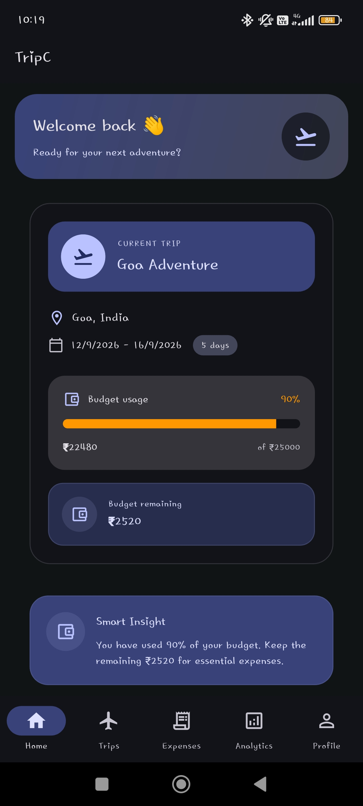
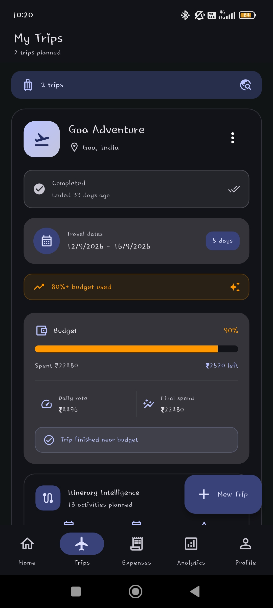
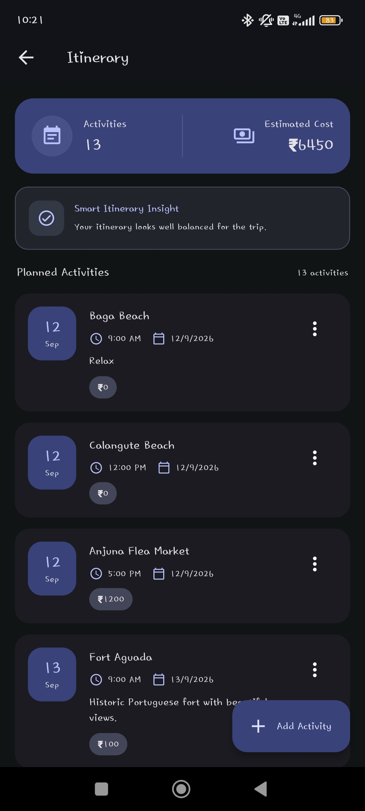
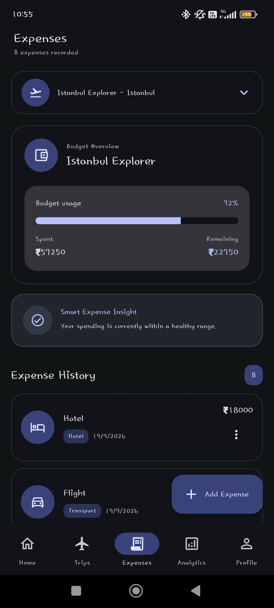
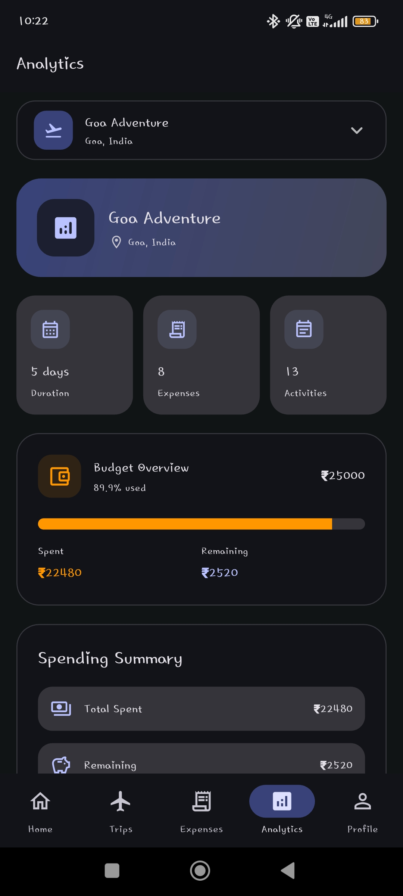
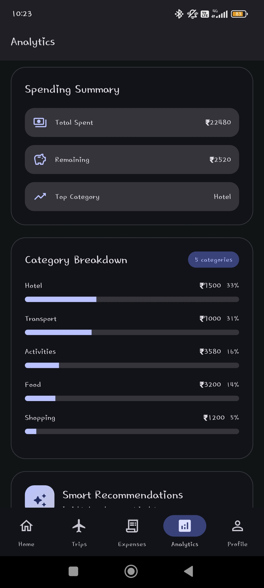
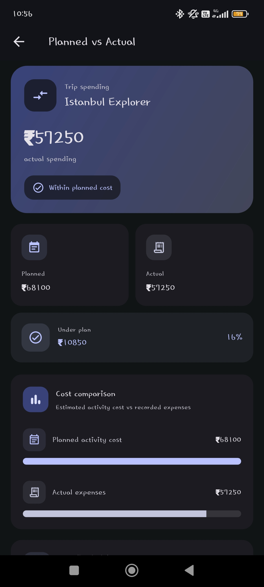
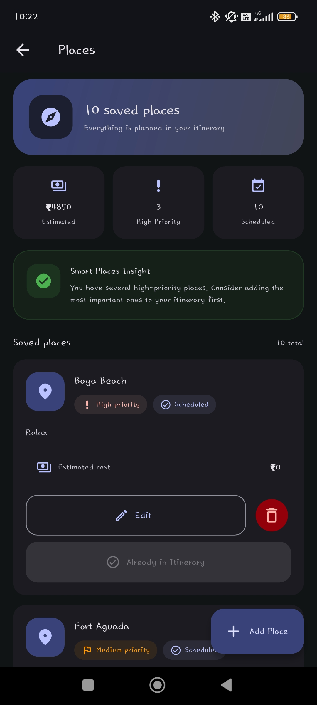

# TripC — Smart Travel Planner & Expense Manager

A Flutter-based travel planning application that helps users organize trips, manage itineraries, track expenses, and monitor travel budgets in one place.

## App Screenshots

### Home Dashboard



### Trip Management



### Itinerary Planning



### Expense Management



### Analytics Dashboard





### Budget Comparison



### Places and Exploration



## Features

- **Trip Management:** Create, view, update, and manage trips.
- **Itinerary Planning:** Organize planned activities and travel schedules.
- **Expense Tracking:** Record trip expenses and review spending by category.
- **Budget Monitoring:** Compare spending against the planned trip budget.
- **Planned vs Actual Analysis:** Compare estimated itinerary costs with actual expenses.
- **Analytics Dashboard:** Review expense breakdowns and trip spending insights.
- **Currency Selection:** View monetary values in supported currencies.
- **Local Data Persistence:** Save trip data on the device using SharedPreferences.
- **Smart Insights:** Display useful spending and itinerary information based on trip data.

## Technology Stack

- **Framework:** Flutter
- **Programming Language:** Dart
- **UI:** Material Design 3
- **Local Storage:** SharedPreferences
- **Data Format:** JSON
- **Development Tools:** Android Studio / VS Code, Git, GitHub

## Getting Started

### Prerequisites

Install the Flutter SDK and configure an appropriate development environment. For Android development, install Android Studio and the Android SDK.

Verify your Flutter setup:

```bash
flutter doctor
```

### Installation

1. Clone the repository:

   ```bash
   git clone https://github.com/afif729/TripC-Smart-Travel-Planner.git
   ```

2. Open the project directory:

   ```bash
   cd TripC-Smart-Travel-Planner
   ```

3. Download dependencies:

   ```bash
   flutter pub get
   ```

4. Run static analysis:

   ```bash
   flutter analyze
   ```

5. Launch the application on a connected device or emulator:

   ```bash
   flutter run
   ```

## Project Structure

```text
lib/
  main.dart
  notification_service.dart

screenshots/
  home.jpg
  trips.jpg
  itinerary.jpg
  expenses.jpg
  analytics.jpg
  analytics-breakdown.jpg
  planned-vs-actual.jpg
  places.jpg

android/
ios/
web/
windows/
macos/
linux/
test/
```

## Data Storage and Limitations

TripC currently uses local device storage through SharedPreferences. Data is not automatically synchronized between devices or users. Uninstalling the application or clearing its data may result in the loss of locally stored trip information.

Currency selection changes the displayed currency; it should not be interpreted as live foreign-exchange conversion unless an exchange-rate service is implemented.

## Future Enhancements

- Cloud backup and synchronization
- User authentication and personalized profiles
- Live exchange-rate integration
- Maps, route planning, and location services
- Travel recommendations and smarter budget predictions
- Expanded automated testing

## Academic Project

TripC is developed as a software engineering project to demonstrate mobile application development, local data persistence, travel and expense management, budget analysis, and dashboard-based data visualization.

## License

No open-source license has been added yet. All rights remain with the project author unless a license is introduced.
